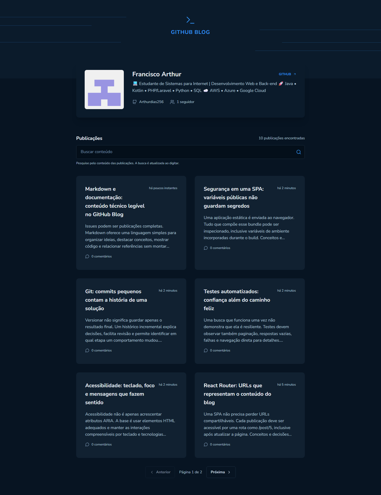
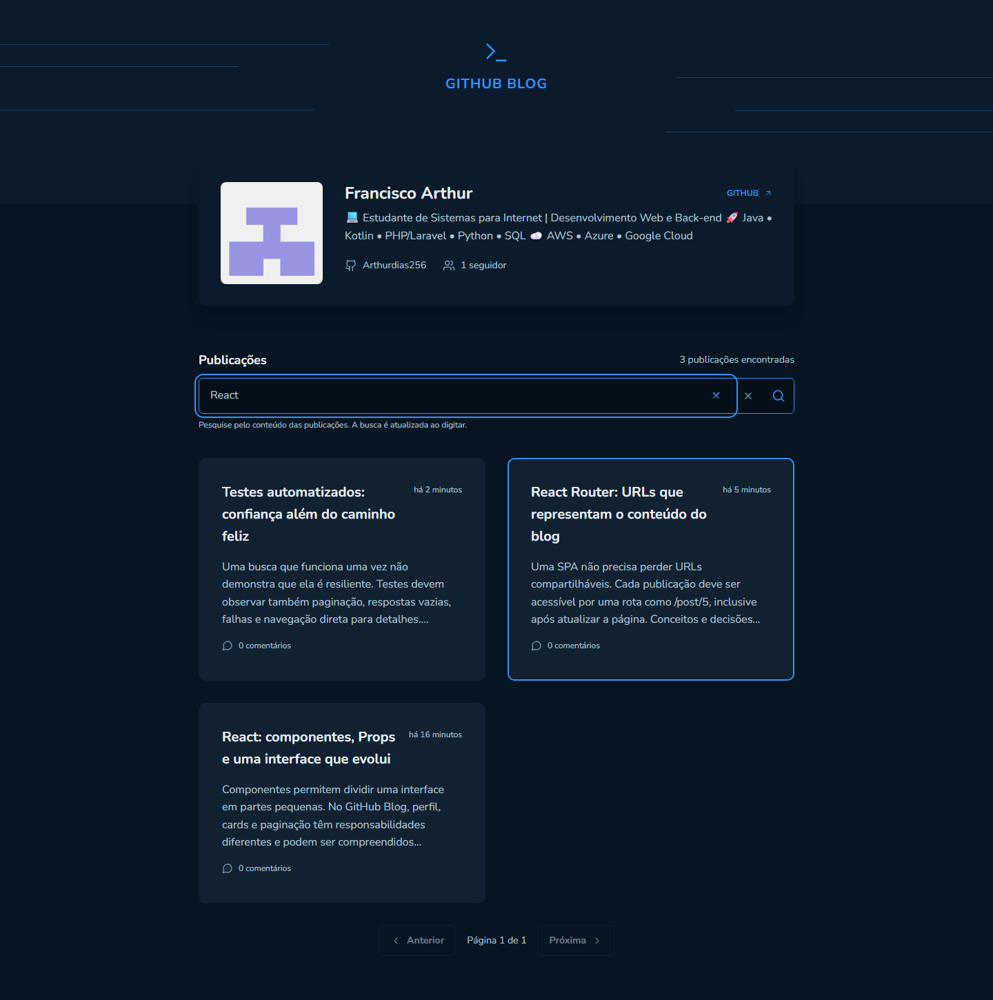
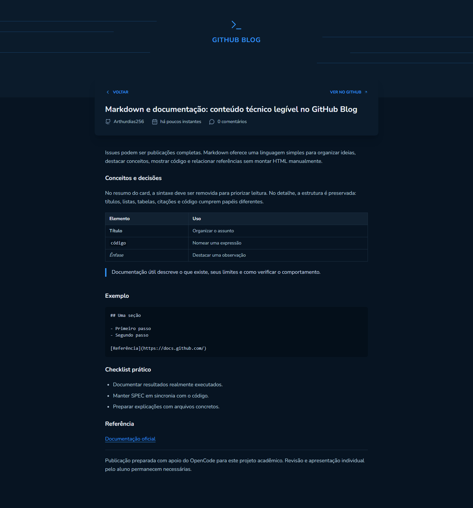
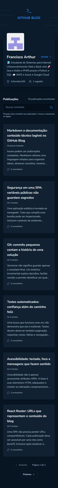

# GitHub-Blog-React-TypeScript-

# GitHub Blog

Blog técnico desenvolvido para a recuperação individual de **Single Page Application (SPA)**. O perfil e as publicações vêm da API pública do GitHub; cada issue do próprio repositório é um post. Projeto desenvolvido com apoio documentado do OpenCode, com revisão/apresentação individual pelo aluno ainda necessárias.

**[Repositório público](https://github.com/Arthurdias256/GitHub-Blog-React-TypeScript-) · [Dez publicações reais](https://github.com/Arthurdias256/GitHub-Blog-React-TypeScript-/issues)**

**Produção:** deployment em preparação; URL será adicionada após publicação verificada.

## Funcionalidades
- Perfil real com avatar, bio, usuário, empresa quando disponível e seguidores.
- Issues abertas/fechadas por criação decrescente, sem pull requests; título, resumo, data relativa e comentários.
- Busca GitHub Search API com debounce 500ms, Enter, cancelamento, contador e estado vazio.
- Paginação real de seis posts, reset em nova busca e consulta/página preservadas na URL.
- Detalhe `/post/:issueNumber`, acesso direto/reload, Markdown/GFM, retorno e link ao GitHub.
- Loading, rede/HTTP, 404, rate limit e retry; interface responsiva, foco/teclado e labels.

## Screenshots reais
Capturadas em navegador com API pública, sem fixtures. Mais evidências em [docs/evidencias](docs/evidencias/).



<details><summary>Busca, detalhe e mobile</summary>





</details>

## Tecnologias e pré-requisitos
Node **>=22.12.0** (validado 24.11.1), npm >=9 (validado 9.3.1) e Git. Stack instalada: React 19.3.1, TypeScript 5.9.3, **Vite 8.3.8**, Tailwind 4.3.5, Axios 1.21.1, React Router 7.18.7, react-markdown 10.1.0 e remark-gfm 4.0.1. Qualidade: ESLint 9.39.5, Vitest 5.1.2, Testing Library, MSW, Playwright 1.65.1 e axe. Todas as versões resolvidas estão no package-lock.json.

## Instalação e execução
```bash
git clone https://github.com/Arthurdias256/GitHub-Blog-React-TypeScript-.git
cd GitHub-Blog-React-TypeScript-
npm ci
npm run dev
```
Abra a URL exibida pelo Vite (normalmente http://localhost:5173). Para personalizar, copie `.env.example` para `.env.local` e reinicie o servidor:
```env
VITE_GITHUB_USERNAME=Arthurdias256
VITE_GITHUB_OWNER=Arthurdias256
VITE_GITHUB_REPOSITORY=GitHub-Blog-React-TypeScript-
```
Esses valores são **públicos**, não segredos. O padrão já funciona sem criar .env. Nunca inclua tokens em VITE_*. O navegador usa o GitHub sem autenticação.

## Validação
```bash
npm ls vite
npm run lint
npm run typecheck
npx tsc --noEmit
npm run test
npx playwright install chromium
npm run test:e2e
npm run build
npm run preview
```
`typecheck`/build executam `tsc -b`, verificando os projetos app e ferramentas; o comando isolado `tsc --noEmit` da raiz não substitui essa verificação porque a raiz contém references.

**Resultados locais atuais:** 31 testes Vitest + 11 Playwright aprovados, zero falhas finais; lint/types/build aprovados. E2E cobre Home/detalhe em 320, 375, 390, 768, 1024, 1440 e 1920px, teclado e axe. Isso não equivale a conformidade integral WCAG. Testes padrão usam MSW/interceptação, sem depender permanentemente do GitHub.

Integração pública real, separada:
```bash
npm run test:api
```
Verifica perfil, repositório público, dez posts, páginas 6+4, busca, vazio, detalhe e ausência de PR/duplicatas. Depende da rede/quota e do conteúdo real. Para capturas reais, com Vite rodando: `node scripts/capture-evidence.mjs`.

## Arquitetura e API
`src/pages` compõe telas; `components` apresenta Props; `services` centraliza Axios/erros; `hooks/useResource` cancela consultas e impede respostas antigas; `types` descreve contratos; `config` concentra ambiente; `utils` prepara resumo/datas. `App` não faz HTTP. Home usa `useState`, `useEffect`, `useCallback` e q/page na URL.

Endpoints: `/users/{username}`, `/search/issues` e `/repos/{owner}/{repo}/issues/{number}`. A Search API é usada também sem termo (alternativa permitida no enunciado), com `repo:... is:issue`, criação decrescente, `page`/`per_page=6`. Isso evita PRs e oferece total real. Limite conservador: até 996 resultados completos; refine a busca além disso. Conteúdo Markdown não executa HTML externo.

```
src/{components,pages,routes,hooks,services,types,config,utils,styles,tests}
tests/e2e/       # testes de navegador
scripts/         # integração real, screenshots e preparação administrativa
docs/            # especificações, roteiro, rubrica e evidências
.github/workflows/ci.yml
vercel.json
```

## Publicações
Dez issues técnicas preparadas especificamente para este repositório, com apoio explícito de IA: React, TypeScript, Axios, Tailwind, Router, acessibilidade, testes, Git, segurança e Markdown. `scripts/seed-issues.mjs` é ferramenta administrativa, nunca código do navegador: verifica conta/permissões e consulta credencial local somente em memória. Não é necessário executá-lo para usar o blog; as issues já existem. O aluno deve revisar e compreender o conteúdo.

## Deploy
Configuração Vercel pronta: Vite, `npm ci`, `npm run build`, saída `dist`, fallback SPA em vercel.json e nenhum segredo no bundle. Para publicar em sua conta autenticada: `npx vercel@50 --prod`. Alternativamente, importe o repositório na Vercel com as configurações acima. Confira Home, busca/paginação e atualização direta de `/post/10`. Não compartilhe tokens no chat ou no Git.

## Documentação e referências
- [PRD — requisitos oficiais e complementares](docs/PRD_SPEC.md)
- [TECH — decisões, versões e arquitetura](docs/TECH_SPEC.md)
- [TASKS — etapas e commits](docs/TASKS_SPEC.md)
- [Matriz da rubrica oficial](docs/RUBRICA.md)
- [Uso de IA — evidências reais](docs/AI_USAGE.md)
- [Roteiro para apresentação individual](docs/APRESENTACAO.md)
- [Notion oficial](https://app.notion.com/p/422dfca74d8d81e194e9dc0aa13ca6f0)
- [Figma oficial](https://www.figma.com/design/UklolDw90CmcDAj9piQVUJ/GitHub-Blog--Community---Copy-?node-id=2-1297)
- [GitHub REST](https://docs.github.com/en/rest), [Vite](https://vite.dev/), [Tailwind](https://tailwindcss.com/), [React Router](https://reactrouter.com/), [Axios](https://axios-http.com/).

## Limitações e entrega acadêmica
O Figma foi consultado visualmente nas páginas Projeto/Style Guide; valores CSS e Header/assets são aproximações, não equivalência pixel-perfect. API pública possui rate limit e indexação eventual; não há cache persistente. E2E foi executado em Chromium (não houve auditoria Safari/Firefox). Medidas de acessibilidade não constituem certificação completa.

O enunciado principal (seções 1–14), a rubrica e as condições da seção 13 foram recuperados na continuação. Permanecem pessoais: revisar código/issues, validar evidências, conferir prazos/regras no Blackboard, enviar links e **apresentar individualmente**. A aprovação exige 71/100 e todas as condições mínimas; não há nota garantida pelo agente.
